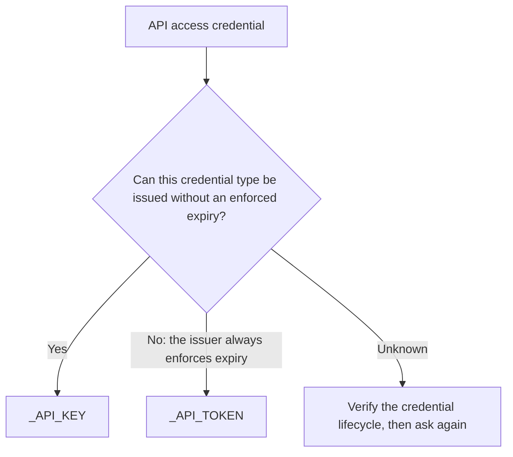

# ENV-NAME-03: Classify KEY Versus TOKEN by Expiry Capability

## Intent

Name an access credential by what its type can do, not by one issued value. A credential configured to expire tomorrow is still a `KEY` when its type supports indefinite validity. A credential is a `TOKEN` only when indefinite validity is impossible because the issuer enforces expiration; continued access then needs renewal or reissuance, which may be automatic.

## Fix

- Provider API token with optional no-expiry: `<PROVIDER>_API_KEY`.
- Provider API token with mandatory expiry: `<PROVIDER>_API_TOKEN`.
- Unknown lifecycle: read the provider's documentation before naming; never guess.
- A `TOKEN` we issue must have issuer-enforced finite expiration; otherwise name and treat it as a `KEY`.

## Edge Cases

- The chart decides only `KEY` versus `TOKEN` for an access credential, including one presented by signing requests. Shared material that grants no access by itself, passwords, asymmetric keys, and certificates take their own taxonomy suffix under `ENV-NAME-02`.
- Provider words such as *token*, *secret key*, or *access token* never decide the suffix.

## Related

ENV-NAME-01, ENV-NAME-02, ENV-BOUN-01
